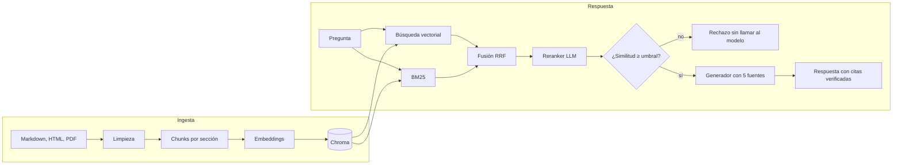

# RAG con evaluación

[](https://github.com/CamiloSTDev/rag-eval-pipeline/actions/workflows/ci.yml)

Asistente de preguntas y respuestas sobre la documentación de FastAPI en español, con un sistema de **RAG**: primero busca los fragmentos relevantes y después un modelo de lenguaje redacta la respuesta solo con ellos. Tiene búsqueda híbrida, un reranker, citas obligatorias y umbral de rechazo. Cada decisión se tomó con números: un golden set de 46 preguntas y una matriz de experimentos que cambia una variable por vez.

Sin LangChain ni LlamaIndex: cada pieza está escrita a mano.

## Probarlo con Docker

```
cp .env.example .env        # y pon tu OPENAI_API_KEY
docker compose up
```

La primera vez ingiere el corpus (unos 40 s) y guarda el índice en un volumen; después arranca directo. La API queda en http://localhost:8000 y su documentación interactiva en `/docs`:

```
curl -X POST localhost:8000/ask -H "Content-Type: application/json" \
     -d '{"question": "¿Puedo montar una aplicación Flask dentro de FastAPI?"}'
```

## Resultados

Todas las corridas son sobre las 36 preguntas de desarrollo (30 con respuesta, 6 sin respuesta en el corpus), con el corpus `126042ddc792`. Cada fila cambia **una** variable respecto de la que indica. Generador `gpt-4.1-mini`, juez `gpt-6-luna`.

| ID | Cambio | Hit@5 | Hit@10 | MRR | Rechazo | Fidelidad | p50 | Tokens de entrada |
|---|---|---|---|---|---|---|---|---|
| E0 | Baseline: solo vectorial, `small`, chunks de 512, 5 fuentes | 0,77 | 0,87 | 0,66 | 0,97 | 0,91 | 2,1 s | 1.037 |
| E0 + umbral | E0 con umbral de rechazo 0,50 | 0,77 | 0,87 | 0,66 | 0,97 | 0,92 | 2,3 s | 998 |
| E1-256 | E0 con chunks de 256 | 0,77 | 0,87 | 0,63 | 0,97 | 0,91 | 2,3 s | 990 |
| E1-1024 | E0 con chunks de 1024 | 0,77 | 0,87 | 0,66 | 0,97 | 0,92 | 2,1 s | 1.046 |
| E2-k3 | E0 con 3 fuentes | 0,77 | 0,87 | 0,66 | 0,94 | 0,90 | 2,3 s | 688 |
| E2-k8 | E0 con 8 fuentes | 0,77 | 0,87 | 0,66 | 0,97 | 0,91 | 2,3 s | 1.514 |
| E3 | E0 con búsqueda híbrida (BM25 + RRF) | 0,80 | 0,90 | 0,70 | 0,97 | 0,91 | 2,3 s | 1.121 |
| E4 | E3 con reranker | 0,93 | 0,93 | 0,90 | 1,00 | 0,94 | 3,1 s | 1.136 + 4.018 |
| E5 | E0 con embeddings `large` | 0,83 | 0,93 | 0,65 | 1,00 | 0,91 | 2,2 s | 1.045 |
| E6 | E0 con `gpt-4.1` como generador | 0,77 | 0,87 | 0,66 | 0,94 | 0,90 | 1,5 s | 1.037 |
| E4-large | E4 con embeddings `large` | 0,97 | 0,97 | 0,93 | 1,00 | 0,94 | 3,1 s | 1.139 + 4.122 |
| **Final** | E4-large con umbral 0,45 | **0,97** | **0,97** | **0,93** | **1,00** | 0,91 | 3,2 s | 1.101 + 3.976 |
| **Hold-out** | Final, sobre las 10 preguntas reservadas | 1,00 | 1,00 | 1,00 | 1,00 | 0,90 | 3,6 s | 1.113 + 3.820 |

Cómo leer la tabla:

- **Hit@5 y Hit@10:** en qué fracción de las preguntas con respuesta aparece una fuente correcta entre los primeros 5 o 10 fragmentos.
- **MRR** (*mean reciprocal rank*): premia que esa fuente esté arriba. Vale 1 si está primera y 0,5 si está segunda.
- **Rechazo:** fracción de preguntas en que el sistema acertó al responder o al negarse.
- **Fidelidad:** fracción de las afirmaciones de cada respuesta que respaldan sus fuentes, según el juez. Es la métrica de alucinación.
- **Tokens de entrada:** del generador, más los del reranker cuando lo hay.
- **Hold-out:** se corrió una sola vez, al final, con la configuración ya congelada. Son 8 preguntas con respuesta y 2 sin respuesta: el 1,00 es buena señal de que la configuración no quedó ajustada a las preguntas de desarrollo, pero con una muestra tan chica no prueba que el sistema no falle nunca.
- **E0-provisional y E4-tokens:** están en `results/` pero no en la tabla. La primera es la corrida previa a corregir el golden set; la segunda, una repetición de E4 para medir los tokens del reranker.

### Hallazgos

- **Los embeddings `large` y el reranker se complementan.** `large` encuentra más fuentes, pero no las ordena mejor: Hit@10 sube de 0,87 a 0,93 y el MRR queda en 0,65. El reranker hace lo contrario y ordena lo que recibe: en E4 el MRR sube de 0,70 a 0,90. Juntos llegan a Hit@5 0,97 y MRR 0,93, porque `large` le lleva al reranker candidatos que antes no aparecían (q030).
- **Lo que no movió la aguja también es un resultado.** El tamaño de chunk (E1) casi no importa, porque los encabezados son fronteras duras y las secciones de FastAPI son cortas. Pasar a 1024 tokens solo reduce los chunks de 1.117 a 1.081. El generador más caro (E6) cuesta unas 4,8 veces más por consulta y no mejora la fidelidad.
- **RRF premia el consenso, no al ganador.** La búsqueda híbrida (E3) arregló q006, q012 y q036, que BM25 pone primeras. Pero empeoró q024 y q029, que eran primeras en la rama vectorial y quedaban muy abajo en BM25. Por eso hizo falta el reranker, que lee el contenido en vez de mirar posiciones.

### Errores que corregí

- **El golden set estaba incompleto.** La primera corrida (E0-provisional) dio Hit@5 0,70. Revisando los fallos aparecieron preguntas con varias secciones correctas en las que el golden set nombraba una sola. Dos revisores independientes, que no veían los resultados, revisaron las 46 preguntas: sumaron 54 fuentes y completaron 9 respuestas. El mismo sistema pasó a 0,77 sin tocar una línea de código. Ninguna fuente se agregó porque el sistema la hubiera recuperado, solo por lo que dice cada sección; así el examen no se califica con las respuestas del alumno.
- **El umbral de rechazo depende del modelo de embeddings.** Con `small`, 0,50 no rechazaba ninguna pregunta con respuesta. Con `large`, ese mismo 0,50 rechazaría q031, que tiene respuesta y queda en 0,499. Se recalibró a 0,45. En los dos casos el umbral solo frena la pregunta sin respuesta más obvia (q040); las demás las rechaza el modelo después de leer las fuentes.

## Arquitectura



El código sigue una arquitectura hexagonal ligera en `src/rag/`, y las dependencias apuntan siempre hacia el núcleo:

- `domain/`: dataclasses y funciones puras (chunker, RRF, métricas, citas). Solo biblioteca estándar.
- `application/`: casos de uso (`IngestCorpus`, `AnswerQuestion`, `Evaluate`), prompts, reranker, juez y los puertos (`typing.Protocol`) que la infraestructura implementa.
- `infrastructure/`: adaptadores concretos (OpenAI, Chroma, rank_bm25, loaders).
- `interfaces/`: CLI y API FastAPI.
- `bootstrap.py`: el único lugar que crea los adaptadores y los inyecta.

Cada experimento cambia un adaptador o un valor de configuración y deja el resto igual. Los tests usan adaptadores falsos, sin red ni costo.

## Preparar el entorno local

Requiere [uv](https://docs.astral.sh/uv/).

```
uv sync
cp .env.example .env        # y pon tu OPENAI_API_KEY
```

`.env.example` ya trae la configuración final. Con DeepSeek como generador, cambia `LLM_PROVIDER` y añade `DEEPSEEK_API_KEY`.

## Uso

```
uv run rag ingest                                         # construye el índice
uv run rag search "¿Cómo declaro un parámetro opcional?"  # fragmentos más parecidos
uv run rag ask "¿Cómo declaro un parámetro opcional?"     # respuesta con citas
```

- **`rag search --mode`:** compara las ramas de búsqueda. `vector` es la búsqueda por significado, `bm25` la búsqueda por palabras y `hybrid` las dos fusionadas con Reciprocal Rank Fusion.
- **`rag ingest --if-empty`:** no hace nada si el índice ya tiene chunks.
- **`rag ask`:** además de la respuesta, muestra la similitud vectorial, la latencia de cada etapa y los tokens del generador y del reranker por separado.

## API

```
uv run uvicorn rag.interfaces.api:app
```

| Endpoint | Qué hace |
| --- | --- |
| `POST /ask` | Recibe `{"question": "..."}` (de 1 a 1.000 caracteres) y, opcionalmente, `top_k` (de 1 a 10 fuentes) y `use_reranker`. Devuelve la respuesta, sus citas, las citas sin fuente, si rechazó, la similitud vectorial, la latencia por etapa y los tokens del generador y del reranker. |
| `POST /ingest` | Reingesta el corpus. Exige el header `X-Admin-Key` con el valor de `ADMIN_API_KEY`; sin esa variable, el endpoint está desactivado. |
| `GET /health` | `200` con la cantidad de chunks indexados, o `503` si el índice está vacío. |
| `GET /version` | Versión del paquete, versión del corpus, configuración activa y un hash corto de ella. |

Errores:

- `422`: la pregunta no es válida, o se pidió un reranker que no está configurado.
- `503`: el índice está vacío.
- `502`: falló el proveedor del modelo o devolvió una respuesta ilegible.

## Evaluación

El golden set está en `data/eval/golden.jsonl`, con una pregunta por línea en JSON. Hay un ejemplo en [data/eval/golden.example.jsonl](data/eval/golden.example.jsonl). Cada línea lleva:

- `id`, `question` y `reference_answer` (la respuesta verificada).
- `relevant_sources`: dónde está la respuesta, como lista de `{"source": ..., "section": ..., "evidence": ...}`.
  - `source` es la ruta dentro de `data/raw`.
  - `section` es la ruta exacta de títulos (opcional, igual que `page` para PDF).
  - `evidence` es una cita literal que respalda la respuesta (opcional).
  - Si varias secciones responden la pregunta, encontrar cualquiera cuenta como acierto.
- `type`: `single` (una sección), `multi` (varias) o `unanswerable` (sin respuesta en el corpus; no lleva `relevant_sources`).
- `holdout`: `true` en las 10 preguntas reservadas para la evaluación final.
- `verified`: `true` cuando la pregunta, la respuesta y sus fuentes se revisaron.

Valida el golden set contra el corpus limpio, sin claves. Comprueba que cada fuente, sección y cita exista tal cual; `--show` lo imprime en formato legible:

```
uv run rag golden --show
```

Corre una evaluación con un nombre de experimento:

```
uv run rag eval E0
```

- **Qué guarda:** `results/E0.csv`, con una fila por pregunta, y `results/E0.json`, con la fecha, la versión del corpus, la configuración y el resumen.
- **No sobrescribe:** se niega a pisar una corrida existente.
- **Hold-out:** con `--holdout` evalúa solo las preguntas reservadas.

Con `JUDGE_PROVIDER` y `JUDGE_MODEL` configurados, un segundo modelo actúa como **juez** y mide la fidelidad y la relevancia. El juez debe ser distinto del generador: un modelo que se califica a sí mismo tiende a aprobar sus propios errores. Está calibrado con 10 respuestas revisadas a mano, en [results/calibracion-juez.md](results/calibracion-juez.md): coincide en 55 de 57 afirmaciones, y cuando se equivoca es por estricto.

Para reproducir un experimento, parte del baseline y cambia una variable:

| Experimento | Variables |
|---|---|
| E0 | `EMBEDDING_MODEL=text-embedding-3-small USE_BM25=false USE_RERANKER=false REFUSAL_THRESHOLD=0` |
| E1 | E0 + `CHUNK_TOKENS=256` o `1024` (y `rag ingest` antes: cada tamaño va en su propia colección) |
| E2 | E0 + `TOP_K_FINAL=3` u `8` |
| E3 | E0 + `USE_BM25=true` |
| E4 | E3 + `USE_RERANKER=true` |
| E5 | E0 + `EMBEDDING_MODEL=text-embedding-3-large` (y `rag ingest` antes) |
| E6 | E0 + `LLM_MODEL=gpt-4.1` |
| Final | los valores por defecto |

## Costo por consulta

El cálculo usa los tokens medidos en la corrida final y precios de rastreadores públicos a noviembre de 2026 (verifícalos en la página del proveedor). Para `gpt-4.1-mini`, que hace de generador y de reranker, son 0,40 USD por millón de tokens de entrada y 1,60 por millón de salida. Por consulta:

- **Generador:** unos 1.100 tokens de entrada y 145 de salida, unos 0,0007 USD.
- **Reranker:** unos 4.000 tokens de entrada y 15 de salida, unos 0,0016 USD.
- **Embedding de la pregunta:** despreciable (unos 15 tokens).
- **Total:** unos 0,0023 USD, es decir, unos 2,3 USD por cada 1.000 preguntas, frente a 0,6 USD del baseline. Reingerir el corpus con `large` cuesta centavos.

Para bajarlo, la palanca obvia es el reranker: es el 78 % de los tokens de entrada. Reordenar 10 candidatos en vez de 20 lo reduciría casi a la mitad, y sería otro experimento por medir.

## Limitaciones y qué haría con más tiempo

- **La muestra es chica.** Son 30 preguntas con respuesta en desarrollo, así que cada una vale 3,3 puntos de Hit@5. Diferencias de pocos puntos en fidelidad son ruido: con temperatura 0, el generador igual cambió la redacción de 21 de 29 respuestas entre dos corridas iguales.
- **Hit@k usa `any()`.** En las preguntas `multi`, encontrar una sola de las fuentes cuenta como acierto aunque la respuesta quede a medias, como pasó con q036.
- **Experimentos que no se pudieron hacer:**
  - BGE-M3 local (E5): el equipo de desarrollo tiene 3,9 GB de RAM y no le cabe.
  - DeepSeek (E6): la cuenta no tiene saldo.
  - Qdrant (E7): no se hizo.
  - El reranker es un LLM y no un cross-encoder local, por la misma falta de memoria.
- **El corpus no trae los ejemplos de código.** La documentación los incluye con directivas que apuntan a archivos aparte, y se decidió quitarlas. Por eso algunas respuestas explican sin mostrar el código, y el modelo a veces lo completa con lo que sabe.
- **El generador cita todo al final** («[1][2][4]») en vez de citar cada afirmación. Un ajuste del prompt podría corregirlo.
- **Para un millón de chunks:**
  - El índice BM25 en memoria no alcanza: haría falta un motor con índice invertido persistente, o una base vectorial con vectores dispersos.
  - Los embeddings de la ingesta irían por lotes asíncronos.
  - La API pasaría a `async` con un caché de preguntas frecuentes.

## Desarrollo

```
uv run pytest -q
uv run ruff check .
uv run ruff format --check .
uv run mypy
```

CI corre lo mismo en cada push. También construye la imagen de Docker y la prueba sin claves: valida el golden set contra el corpus que trae la imagen y comprueba que el contenedor no corre como root.

## Corpus

Es la documentación de FastAPI en español (licencia MIT). La procedencia exacta está en [data/PROCEDENCIA.md](data/PROCEDENCIA.md).
